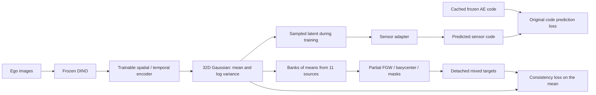
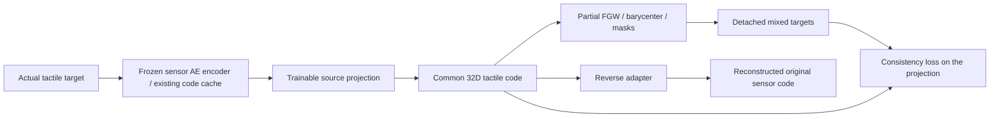

# How FGW alignment and mixing works in TactileLatent

This document describes the implementation used by the current two-placement
first test. Its explanation follows the actual code, including normalization,
losses, partial matching, gradient flow and checkpoint initialization.

**The central idea:** find soft correspondences between interaction states
from different datasets, combine the corresponding representations, and train
the model toward those combined representations while preserving its ability
to predict each sensor's original output.

FGW supplies correspondences. The barycenter supplies shared reference states.
Stochastic mixing supplies augmented latent targets. Neural-network training
is what changes the representation.

## 1. What is a point in the latent space?

A point represents an interaction state at a particular valid frame. It is
not a tactile pixel, a taxel, a latent dimension, or an entire dataset.

The visual model processes eight-frame clips, sampled with stride two: frame
indices are typically `start + [0, 2, 4, 6, 8, 10, 12, 14]`. For FGW, one
point per sampled clip is selected: the **last frame with a valid tactile
target**. It can precede the clip's last image if the final target is missing.

Each source contributes up to 256 distinct clip states to a bank. Episodes are
sampled in rounds so a long episode does not dominate the bank. A source with
fewer valid states contributes fewer points. All eleven sources participate;
MotionTrans is excluded.

The representations entering the mixer always have 32 coordinates:

| Placement | The 32D point supplied to FGW |
|---|---|
| Visual | The shared visual encoder's Gaussian mean, `mu`, at the selected frame |
| Tactile-first | A learned source-specific projection of the actual tactile code or numeric reading |

The frozen sensor autoencoders still have their original code dimensions.
Their 16D, 32D or 256D codes are not directly compared as if their coordinates
were interchangeable. The common 32D representation is a separate object.

## 2. How this relates to ICP

ICP alternates estimating point correspondences and updating a geometric
transformation. Our training alternates estimating latent correspondences
and updating a neural network.

| ICP component | Component here |
|---|---|
| A cloud of 3D points | A bank of 32D interaction representations |
| Corresponding points | A soft transport plan |
| Reference cloud | Shared barycenter support |
| Rotation/translation update | Gradient updates to the visual encoder or tactile projections |
| Re-estimate correspondences | Refresh banks and transport plans next epoch |

We do not estimate a rigid rotation matrix. We also do not apply a separate
dataset-specific coordinate correction to every prediction at inference.
The learned encoder is expected to internalize the alignment.

## 3. What FGW compares

Let source `s` have a bank of points:

$$
U_s = [u_{s,1},\ldots,u_{s,N_s}]^\top \in \mathbb{R}^{N_s\times32}.
$$

Let the shared support contain `K` reference points:

$$
B = [b_1,\ldots,b_K]^\top \in \mathbb{R}^{K\times32}.
$$

For each source, FGW combines two costs:

**Coordinate similarity:** is a source code close to a reference code?

$$
M_{s,ij} = \frac{\|b_i-u_{s,j}\|_2^2}{\ell^2}.
$$

**Relational similarity:** do two corresponding pairs have similar distances
within their respective point clouds?

$$
C^B_{ik}=\frac{\|b_i-b_k\|_2}{\ell},\qquad
C^s_{jl}=\frac{\|u_{s,j}-u_{s,l}\|_2}{\ell}.
$$

For example, matching one pair becomes less attractive if it requires two
nearby reference states to correspond to very distant source states. This
tests relationships among points rather than considering each match alone.

The distinction between feature and relational costs is the defining FGW
construction. [Original FGW paper, Vayer et al., ICML 2019](https://proceedings.mlr.press/v97/titouan19a.html).

### What supplies these similarities in this implementation?

The costs above use the current common latent coordinates. There are no
manual state labels, physical anchors, separate DINO-similarity costs, force
calibration tables or anatomical cross-sensor correspondences.

DINO is an input feature extractor for the visual encoder. Its features
influence `mu`, but are not an additional term in the transport cost.

The distances are a hypothesis about interaction similarity, not verified
physical distances. In particular, optical brightness, pressure and signed
force are not assumed to be the same measurement.

### The fixed distance scale

At the first active mixer refresh, the code computes the median positive
within-bank distance for each nonconstant source and averages those medians
to obtain `ell`. If all banks are constant, it uses one.

That scale is retained on later epochs. It is not recomputed every time the
network contracts its latent clouds. Otherwise normalization could hide
shrinking distances. The scale does not give the latent coordinates physical
units.

## 4. The transport plan and its optimization

For source `s`, the solver returns:

$$
T_s\in\mathbb{R}^{K\times N_s}_{\geq0}.
$$

Rows refer to barycenter support points; columns refer to source states.
`T_s[i,j]` is transported mass associated with that correspondence. It is not
a probability that a pressure prediction is correct.

Using `alpha = structure_weight`, the objective in our implementation is:

$$
\min_{T_s}\;
(1-\alpha)\sum_{ij}M_{s,ij}T_{s,ij}
+\alpha\sum_{ikjl}(C^B_{ik}-C^s_{jl})^2T_{s,ij}T_{s,kl}.
$$

The second term couples pairs of correspondences, making the problem
nonconvex. The solver can find a local solution; a unique physically correct
matching is not guaranteed.

| `structure_weight` | Behavior |
|---|---|
| 0 | Feature-only optimal transport |
| 0.5 | Both terms, as used in the current pilot |
| 1 | Pure Gromov–Wasserstein matching |

These are coefficients, not a promise that the two numerical contributions
have equal magnitudes when the coefficient is 0.5. Our configuration names
the structural weight explicitly because alpha conventions differ between
publications and libraries.

### Balanced matching

The support and source marginals are uniform:

$$
p_i=1/K,\qquad q_{s,j}=1/N_s.
$$

Balanced transport imposes:

$$
T_s\mathbf1=p,\qquad T_s^\top\mathbf1=q_s.
$$

It transports all available mass, so every state must participate. That can
force matches between states that are absent from another dataset.

### Partial matching: the current pilot

The pilot uses `transported_mass = 0.75`, with:

$$
T_s\mathbf1\leq p,\qquad T_s^\top\mathbf1\leq q_s,\qquad
\sum_{ij}T_{s,ij}=0.75.
$$

This lets the solver leave some mass unmatched. The 0.75 value is a configured
overlap assumption. The solver does not independently infer that the datasets
share exactly 75% of their physical states. Partial FGW with an explicit mass
budget is supported by POT. [Official partial-FGW example](https://pythonot.github.io/auto_examples/gromov/plot_partial_fgw.html).

Transporting 75% of the mass does not necessarily mean exactly 75% of states
are matched: some plans can split mass across more states. `matched_fraction`
counts source columns receiving nonzero mass, separately from total mass.

The partial objective is used without dividing its terms by the transported
mass. Its linear feature term and quadratic structural term therefore scale
differently when that mass changes. The pilot holds the mass fixed.

## 5. Constructing the shared barycenter

The barycenter is a set of reference codes, not one global mean vector and
not a set of hand-labeled interaction classes.

Initially, its 256 support points are drawn from source banks by cycling
through the sources. Later epochs reuse the previous support coordinates
when their shape matches. The support is stored as training state; it is not
a trainable parameter inside the inference model.

Each refresh performs five alternating rounds:

1. Hold the reference coordinates fixed and solve one FGW problem per source.
2. Hold those transport plans fixed and update each reference coordinate.
3. Repeat with the updated support.

Sources receive equal overall weights, `w_s = 1/11`. The coordinate update is:

$$
b_i^{\mathrm{new}}=
\frac{\sum_s w_s\sum_j T_{s,ij}u_{s,j}}
     {\sum_s w_s\sum_j T_{s,ij}},
$$

when the denominator is positive. An unsupported reference point retains
its previous coordinate.

This formula normalizes by the mass actually received. In partial matching,
different sources can contribute different amounts to a particular point.
Equal overall source weights do not require equal contributions at every
individual support point.

After five updates, the code solves the source transport plans again against
the final support. Those final plans are used for mixing.

**This is an OTM-style alternating barycentric approximation.** The weighted
coordinate update alone does not exactly minimize the entire FGW objective,
because the relational cost also changes with the coordinates. We do not
claim a globally optimal FGW barycenter.

The approach is inspired by the latent mixer of Gong, Yue and Xu, which uses
FGW barycenters and transported representations for unaligned multimodal
learning. Our existing frozen autoencoders and shared visual encoder lead to
the two adaptations described below. [AAAI 2025 paper](https://ojs.aaai.org/index.php/AAAI/article/view/33849).

## 6. Pushing codes into shared support coordinates

For each source, aggregate the states assigned to reference point `i`:

$$
a_{s,i}=\sum_jT_{s,ij},\qquad
v_{s,i}=\frac{\sum_jT_{s,ij}u_{s,j}}{a_{s,i}}.
$$

`v_s[i]` is that source's contribution at shared support point `i`. Sources
whose row mass is effectively zero are marked unsupported there.

Dividing by mass is essential. A raw matrix product `T_s @ U_s` is a
mass-weighted sum; it changes the magnitude of the codes when support size or
transported mass changes. A constant code should remain constant after
transport, not shrink by `1/K`.

The implementation considers mass above `1e-12` supported and uses `1e-15`
as a numerical denominator floor. Unsupported rows cannot supply mixing
coordinates.

## 7. Stochastic coordinate mixing

Once source contributions occupy the same support indices, the mixer can
combine them. For each support point `i` and latent coordinate `d`, it
randomly selects exactly one supported source:

$$
\widetilde b_{i,d}=v_{s(i,d),i,d}.
$$

Equivalently, define binary masks `H_s` with one selected source per
coordinate:

$$
\widetilde B=\sum_s H_s\odot V_s,\qquad
\sum_sH_{s,i,d}=1
$$

where support is available. If no source supports a reference point, that
row keeps its existing reference code.

For instance, coordinate 1 of a mixed reference code may come from one
source and coordinate 2 from another source assigned to the same reference
state. Coordinates are latent features, not identified fingers or force
components. We do not mix raw images or assign one sensor's raw target to
another sensor.

Binary selection preserves individual coordinate contributions instead of
always averaging them. It is intended to reduce excessive smoothing, but
can also produce combinations outside a source's original latent manifold.
That effect must be assessed through reconstruction and transfer.

The masks are generated once per epoch refresh using a reproducible local
random generator. They are not resampled for each minibatch. Our implementation
uses binary masks; the authors' released clustering code uses Dirichlet
weights to form continuous mixtures. [Reference implementation](https://github.com/redLinmumu/OTM/blob/main/mwae/utils/get_distance.py).

The deterministic variant would use the coordinate barycenter directly.
The active pilot uses the stochastic partial variant for both placements.

## 8. Pulling the mixed codes back to source states

Training samples need targets in their own sample order. Use the transpose
of the same transport plan to aggregate mixed support codes:

$$
r_{s,j}=\sum_iT_{s,ij},\qquad
\widetilde u_{s,j}=
\frac{\sum_iT_{s,ij}\widetilde b_i}{r_{s,j}}.
$$

A source state with zero transported mass keeps its original code as the
stored fallback and is excluded from the consistency loss. It can still
participate in reconstruction, numeric prediction and the spread penalty.

The consistency loss averages over supported states. It does not weight
each supported state by how much mass its column received.

### Worked arithmetic example

Use two-dimensional codes here for readability; training uses 32 dimensions.
Suppose source A has:

```text
U_A = [[2, 4],
       [6, 8]]

T_A = [[0.25, 0.125],
       [0.00, 0.375]]
```

The plan has total mass 0.75. Its row and column sums respect uniform
marginal capacities of 0.5.

Pushing A's codes gives:

```text
First support point: [1.25, 2.00] / 0.375 = [3.3333, 5.3333]
Second support point: [2.25, 3.00] / 0.375 = [6.0000, 8.0000]
```

Suppose another source supplies `[4,10]` and `[8,12]` at those support
points. A possible coordinate mask selects A then B for the first point,
and B then A for the second:

```text
Mixed support = [[3.3333, 10.0],
                 [8.0000,  8.0]]
```

Pulling back through A's plan gives:

```text
Target for A state 1 = [3.3333, 10.0]
Target for A state 2 = 0.25 * [3.3333, 10.0] + 0.75 * [8.0, 8.0]
                     = [6.8333, 8.5]
```

These are latent consistency targets. The measured tactile targets for A's
samples remain A's original measurements. This example explains arithmetic;
it does not introduce manually labeled matches into training.

## 9. Placement A: align visual representations directly



The shared visual network produces a Gaussian for every frame:

$$
z=\mu+\epsilon\odot\exp(\tfrac12\operatorname{logvar}),\qquad
\epsilon\sim\mathcal N(0,I).
$$

FGW sees `mu`, not random draws from this Gaussian. The ordinary sensor
adapter receives a sampled `z` during training. The alignment loss is
applied to the current mean at the bank state's selected frame.

The original task remains:

- For AE-backed sensors: predict the cached, train-standardized sensor code
  through the existing adapter; use mean squared error over its coordinates.
- For numeric sensors: predict the original normalized readings through a
  simple sigmoid head; use squared error plus 0.5 times absolute error.

Frozen sensor decoders reconstruct native outputs for evaluation and the
viewer. They are not invoked by the training loss. Code errors are measured
in standardized sensor-code coordinates, not directly in raw pixel space.

The complete visual objective is:

$$
L_A=L_{\mathrm{task}}+\beta L_{\mathrm{KL}}
+\lambda_eL_{\mathrm{consistency}}+\eta L_{\mathrm{spread}}.
$$

For supported anchor states:

$$
L_{\mathrm{consistency}}=
\operatorname{mean}_{s,j\;\mathrm{supported}}
\left[\frac1{32}\|\mu_{s,j}-\operatorname{stopgrad}(\widetilde u_{s,j})\|_2^2\right].
$$

The code computes losses in source-homogeneous minibatches, not one giant
11-source minibatch. The expression describes the contributing states;
aggregation follows the existing sampler and gradient accumulation.

`lambda_e` is 0.05 in the first new joint epoch and 0.1 from the second.
The KL weight has already reached its existing 0.001 maximum at this
continuation point. KL is averaged over valid frames and latent coordinates.

## 10. Placement B: align tactile representations first



For an AE-backed source, start with its standardized cached code `c_s`:

$$
u_s=P_s(c_s),\qquad \widehat c_s=R_s(u_s).
$$

The projection is `code_dim → 128 → 32`, with GELU. Its reverse adapter is
`32 → 128 → code_dim`, also with GELU. Numeric sources use a linear
projection from their one/two normalized values and a linear sigmoid
prediction head back to those values. Their projections add no information
beyond the measured one/two-dimensional input.

This stage has no visual encoder and no Gaussian KL term:

$$
L_{\mathrm{teacher}}=L_{\mathrm{code\ reconstruction}}
+\lambda_eL_{\mathrm{consistency}}+\eta L_{\mathrm{spread}}.
$$

The first 20 teacher epochs use reconstruction with the spread penalty;
mixed-target consistency is inactive. The next 50 activate FGW and its
two-epoch consistency ramp. This is one teacher, not a search over teachers.
It uses AdamW; it does not use SAM or load native tactile images.

After training:

1. Freeze the learned projections and reverse adapters.
2. Cache common 32D codes for source training and validation frames.
3. Keep those common coordinates unchanged: do not normalize them separately
   for each source, which would undo learned offsets and scales.
4. Train the visual model to predict the frozen common codes, while keeping
   its original sensor-code/numeric prediction losses.

Its visual-stage objective is:

$$
L_B=L_{\mathrm{task}}+\beta L_{\mathrm{KL}}
+\gamma\operatorname{MSE}(\mu,P_s(c_s))+\eta L_{\mathrm{spread}},
\qquad\gamma=1.
$$

Common-code supervision applies to all valid frames of training clips, not
only terminal bank states. There is **no second visual FGW solve** in this
placement. The spread penalty still uses visual banks.

Inference uses the shared visual encoder and its ordinary sensor adapters.
It needs neither actual tactile input nor the common tactile teacher.

## 11. Preventing collapse: the actual spread penalty

Sending every state to the same latent vector could reduce alignment error
while losing interaction information. Original reconstruction/prediction
supervision opposes that, and a spread penalty adds another constraint.

Let `v_s^0` be the mean coordinate variance in the first bank recorded for
source `s`. This is the first continuation bank for the visual network and
the first warmup bank for the tactile teacher. Define:

$$
v_s^{\mathrm{ref}}=\max(v_s^0,10^{-8}),\qquad
L_{\mathrm{spread},s}=
\frac{\max(0,0.5v_s^{\mathrm{ref}}-v_s)^2}{(v_s^{\mathrm{ref}})^2}.
$$

Its weight `eta` is 0.01. It constrains average variance, not the variance
of every coordinate. A scalar force sensor is not forced to fill 32
independent directions.

The minibatch implementation inserts its current anchor codes into the
detached epoch-start bank and computes variance over that hybrid bank.
Repeated bank positions within a minibatch are averaged before insertion.
Gradients flow through the replaced rows only; other rows remain snapshots.
Thus this is a sampled, partly stale estimate, not the exact variance of all
current dataset representations. It discourages collapse but does not
guarantee semantic information or complete protection from collapse.

## 12. One epoch, gradient flow and SAM

An active visual-alignment epoch proceeds as follows:

1. Select fresh episode-balanced banks from training clips only.
2. Encode those clips in evaluation mode without gradients or training
   dropout. Store the relevant mean codes.
3. Solve source-to-support plans and update the barycenter five times.
4. Generate one set of coordinate masks and pull back detached targets.
5. Replace approximately 25% of each source's ordinary clip budget with
   bank clips; round up for small budgets. Keep source-homogeneous batches.
6. Train on original sensor supervision for all valid frames. Apply
   consistency and spread at deliberate bank anchors.
7. Validate native reconstructions and save regular model/epoch checkpoints.
8. Repeat with refreshed representations next epoch.

Each frame within a clip retains its correct chronological position and
sensor pairing. Random training-clip selection does not reorder frames
inside the video/target sequence. FGW does not add explicit temporal edges
or align video timestamps across datasets. Temporal information enters the
visual means through the existing temporal encoder; the tactile projection
itself operates per frame.

### Gradients

Transport solves run on detached float64 NumPy arrays. Targets are converted
to float32 tensors. There is no differentiation through the optimal
transport solver, masks or barycenter computation.

Gradients enter the current visual encoder and sensor adapters, or the
current tactile projections and reverse adapters. They do not update DINO,
the original sensor autoencoders, or cached target codes.

This is alternating optimization: estimate correspondences outside the
optimizer, then train toward the resulting targets.

### SAM replay

The visual stage retains SAM AdamW. Its second pass uses the same cached
DINO features, view masks, Gaussian/dropout random state, teacher targets,
alignment targets and bank payload as the first pass. It does not recompute
FGW or redraw mixing masks after perturbing weights. This makes the
perturbation test the same minibatch objective.

The mean and log-variance heads can both receive gradients from the
original stochastic prediction task. Alignment consistency acts directly
on the mean, not on the log-variance head.

## 13. What “start at epoch 10” means

Both new joint models load:

`processing/runs/joint_alignment_holdout_motiontrans/epoch_010.pt`

That checkpoint already contains ten completed epochs of the previous
joint sensor-code alignment model. It supplies the shared spatial/temporal
encoder, Gaussian heads, sensor adapters, numeric heads and Adam optimizer
state. The fixed DINO revision and frozen sensor teachers remain pinned.

The checkpoint's internal epoch index is nine because storage uses
zero-based indices. Loading it sets the next loop index to ten, which is
reported as **epoch 11**. Initially the new jobs were configured for epochs
11 through 20. On October 12, 2026 the endpoint was extended to **epoch 30**:
twenty additional epochs per placement, forty across both.

The optimizer momentum is inherited; a new learning-rate scheduler is
created for the continuation. The active visual run hands over at its next
complete checkpoint and stretches the remaining cosine decay to epoch 30
without restarting warmup or increasing its current learning rate. The
queued tactile-first run starts with a twenty-epoch continuation schedule.
Its two-epoch learning-rate warmup
is separate from the two-epoch mixer-loss ramp. Both placements start from
the same parent weights and use seed 45.

The FGW banks, reference support and mixing targets are initialized for the
new objective; they are not loaded from the old non-FGW parent. The
tactile-first teacher is separately initialized and trained from scratch.

This is a warm-start experiment. Comparing its result to the old epoch-10
model also compares additional training and, for tactile-first, additional
teacher supervision. With no new matched control, an improvement cannot
be attributed exclusively to FGW.

## 14. Current settings and saved artifacts

| Setting | Current first test |
|---|---|
| Joint models | Visual placement and tactile-first placement |
| Seed | 45 |
| Variant | Stochastic partial FGW |
| Source datasets | Eleven; MotionTrans excluded from alignment |
| Common dimension | 32 |
| Source bank size | Up to 256 valid states per source |
| Shared support size | 256 |
| Barycenter rounds | 5, followed by final transport refitting |
| Structural weight | 0.5 |
| Transported mass | 0.75 |
| Mixer consistency weight | 0.1, ramped over two active epochs |
| Spread weight | 0.01 |
| Bank clip fraction | Approximately 25% |
| Tactile teacher | 20 warmup + 50 FGW epochs |
| New joint training | Epochs 11–30 for each placement |
| Screening / extra seeds | None |

The solver is pinned to POT 0.9.6.post1. Balanced FGW uses a 100-iteration
outer limit. The partial implementation shares its limit with an inner EMD
solve, so it uses a separate 10,000-iteration limit and eight dummy points.
Those dummy points represent unmatched mass, not additional interaction
states. A mass-one partial solve uses the equivalent balanced solver.

Solver warnings, nonfinite values and violated mass/marginal constraints
stop a job. Invalid plans do not become pseudo-targets.

Training artifacts live under `processing/runs/fgw_two_placements_v1`:

- `pilot.json`: fixed experiment specification and provenance fingerprints.
- `status.json`: active controller stage and worker log.
- `fgw_visual_partial_seed45/alignment/`: sampled window/frame identities,
  original banks, plans, reference support, mixed targets and diagnostics.
- `tactile_teacher/alignment/`: corresponding code-only teacher artifacts.
- `common_codes/`: frozen per-frame common tactile codes after teacher training.
- The two model directories: ordinary checkpoints and per-epoch viewer snapshots.
- `summary.json`: native reconstruction and MotionTrans transfer results.

The tactile-first visual stage has no FGW plans of its own; inspect the
teacher's alignment artifacts for its transport/mixing behavior.

Useful diagnostics include transported mass, matched fraction, bank
variance, effective rank, target displacement and row entropy. The saved
correspondence-stability statistic compares the strongest support index for
states shared between successive banks. It is available only when overlap
exists, and moving support coordinates make it an approximate diagnostic.
None of these diagnostics verifies a physical match by itself.

The implementation is in [fgw_mixer.py](src/tactilelatent/fgw_mixer.py),
[fgw_data.py](src/tactilelatent/fgw_data.py),
[fgw_objective.py](src/tactilelatent/fgw_objective.py),
[tactile_teacher.py](src/tactilelatent/tactile_teacher.py) and
[train_alignment.py](src/tactilelatent/train_alignment.py).
The active queue is defined by [fgw_pilot.py](src/tactilelatent/fgw_pilot.py).
Operational instructions are in [FGW_STUDY.md](FGW_STUDY.md).

## 15. What this establishes—and what still needs evaluation

**FGW alignment is self-supervised across datasets.** It requires no manual
cross-dataset pairing. Original measured tactile outputs still supervise
reconstruction/prediction, and within-dataset visual-to-tactile pairing must
remain correct. Unpaired across datasets does not mean frames can be
shuffled against their targets within one dataset.

Geometry alone can have equally good correspondences under symmetries,
rotations or reflections. The coordinate term helps choose a common basis,
but can also reinforce arbitrary early coordinates. Independently learned
sensor codes can encode texture, sensor background and nuisance variation
alongside interaction information. Preserving their reconstruction therefore
does not prove physical invariance.

Partial matching avoids forcing every state to align, but its fixed mass
can still exceed genuine overlap. Coordinate mixing may create implausible
latent combinations. The extra 32D tactile bottleneck may lose information
from a larger sensor code. These are questions for native reconstruction
and held-out transfer evaluation, not conclusions from the transport loss.

For the current first test, both final visual models are evaluated on
MotionTrans with the previously requested shallow and deep heads. Head
fitting uses MotionTrans training episodes; the shared encoder remains
frozen. MotionTrans never supplies FGW costs, banks or teacher statistics.
Its previously inspected validation is a development benchmark, not a
pristine final test set.

**MotionTrans transfer is the primary objective of this first test.**
Improvement on the eleven source datasets is not required. Their validation
losses and reconstructions are diagnostic checks on retained information,
not criteria for choosing, stopping or extending either placement. The
pilot trains both to the requested epoch-30 endpoint. Requested intermediate
evaluations use immutable completed checkpoints and leave joint training
running.

Finally, three different uncertainties must not be conflated:

| Quantity | Meaning |
|---|---|
| Soft transport / row entropy | Ambiguity or dispersion in a matching plan |
| Random coordinate masks | Training augmentation randomness |
| Gaussian latent draws | Variability propagated through the visual prediction model |

None automatically produces calibrated prediction intervals. The pilot
reports empirical coverage from Gaussian latent draws. Its separate
calibration stage is deferred. Alignment success is assessed through
MotionTrans transfer accuracy; source reconstruction is diagnostic. Calibrated uncertainty
requires its own held-out calibration and coverage checks.
