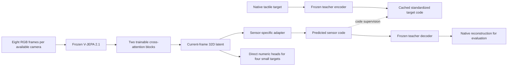

# Architecture and scientific contracts

This explains the **17-source deterministic current-frame V-JEPA workflow** observed in the [state snapshot](project_state.md). Earlier architectures remain documented in the [archive](archive/README.md); they are not silently converted into this model.

## Two stages of learning

First, source-specific tactile autoencoders learn to reconstruct native measurements. Their encoders produce compact **sensor-specific codes** and their decoders reconstruct pressure, taxels, marker displacement or numerical signals. These teachers are then frozen and their target codes are cached. Simple one/few-value sources use direct heads instead.

Second, a shared video model predicts a **32D visual tactile latent**. A source-specific adapter turns that common latent into the appropriate sensor code; the objective compares it with the frozen teacher's standardized code. Frozen decoders are used for native reconstruction evaluation and visualization. The common 32D latent is distinct from each teacher's code, which can be larger or smaller.

## Video and attention, step by step

1. Load eight ordered images at input stride two, ending at the supervised frame. This is the current image plus seven earlier sampled images, spanning 15 original frame positions. Existing source timestamp/frame mappings determine valid chronological pairing; no future frame is an input.
2. Keep the main/ego, left wrist and right wrist camera slots with availability masks. A fixed-scene source retains its recorded camera role. Source RGB is decoded at 384×384; tactile measurements are not resized. Mirroring, when selected, transforms the entire clip and targets before wrist dropout.
3. Run each available camera's whole eight-frame clip through frozen V-JEPA 2.1 Base/16. Its patch embedding uses temporal tubelets of two frames, producing four temporal groups. Transformer context spans the clip; a token is not restricted to an isolated two-frame prediction.
4. Retain all `4 × 576 × 768` tokens per available camera. With three reserved camera slots the restored feature tensor is `[B,4,3,576,768]`. No spatial averaging or persistent visual-feature cache is used in this workflow.
5. Apply `LayerNorm(768)` and a trainable `Linear(768,256)`. Add 24×24 spatial, four-group temporal and camera-role embeddings. Flatten into 6,912 memory positions, masking absent/dropped cameras.
6. Start one learned current-frame query of width 256, with final-frame and ordered-pair-slot encodings. Two pre-normalized TransformerDecoder blocks update that query through query self-attention, cross-attention to memory, and a feedforward MLP. Each has four attention heads, feedforward width 1,024 and dropout 0.1. The frozen memory tokens are read, not rewritten by these decoder blocks.
7. Map the final query through `LayerNorm(256) → Linear(256,128) → GELU → Linear(128,32)`. This yields one deterministic 32D vector for the final tactile target. The active model has no learned variance branch, latent sampling or KL loss.
8. Use the appropriate source adapter `32 → 128 → 128 → sensor_code_dim` or a direct numerical head. Code coordinates are standardized with fixed training-only statistics; decoding restores the original source code convention first.

Implementation: [`models/backbone.py`](../src/tactilelatent/models/backbone.py),
[`attention.py`](../src/tactilelatent/models/attention.py),
[`joint.py`](../src/tactilelatent/models/joint.py),
[`heads.py`](../src/tactilelatent/models/heads.py), and
[`autoencoders/`](../src/tactilelatent/models/autoencoders/). These are actual implementations;
current model code has no DINO-era inheritance chain. The small
[`initialization.py`](../src/tactilelatent/models/initialization.py) explicitly preserves
legacy constructor RNG consumption for the default initialization.

The attention overlay shows the trained query-to-memory cross-attention weights, separated by camera, temporal group, layer and head. These relative weights are not causal feature attribution, contact probabilities or a calibrated confidence map. Read the [attention walkthrough](attention_block_walkthrough.md) for the exact Q/K/V operations and [manual example](../examples/manual_attention_block.py).

## Current heads and targets

| Source | Target representation | Sensor code / head |
|---|---|---:|
| EgoTouch | Native bilateral 21×21 pressure | 256D code |
| EgoTactile | Recorded native tactile target | 16D code |
| OpenGraph | Native two-hand finger taxels | 16D code, two shared-hand 8D codes |
| OpenTouch | Recorded native taxels with existing channel masks | 32D code |
| FTP ViTaMIn | Native optical tactile image | 256D code |
| FTP Unit | Marker displacement | 8D code |
| FTP Unit Bimanual | Two-surface marker displacement | 16D code, two shared-hand 8D codes |
| FTP VLA Touch | Marker displacement | 8D code |
| Baihu | Four-surface marker displacement | 32D code |
| EgoPressure | Native 224×224 hand-relative UV pressure | 64D code |
| FEEL Kitchen | 12 native processed contact estimates | 6D code |
| HRDexDB Inspire F1 | 24 native force/direction components | 12D code |
| T-Rex | 60 native fingertip wrench components | 16D code |
| FTP RDP / RDP Bimanual | One / two recorded force channels | Direct numeric heads |
| FEEL Lab / HRDexDB Allegro V5 | Five / four native readings | Direct linear heads |

Exact native layouts, teacher parameters and code statistics come from the prepared model/teacher registry linked in [project state](project_state.md), not this explanatory table. The RDP paths preserve their existing signed normalized convention. FEEL Lab and Allegro use training-RMS/asinh supervision with nonnegative native decoding. Native units, zero conventions and validity masks remain source-specific.

## Training, evaluation and compatibility boundaries

Each batch contains one source; sources are sampled through the existing capped/cycling schedule. SAM AdamW makes a first gradient pass, perturbs trainable weights and replays the same supervised examples/features before updating. Detached frozen video features, selected mirror transforms and targets are preserved for replay. Frozen V-JEPA and tactile teachers receive no gradients.

Validation uses fixed unaugmented source clips and source-appropriate native reconstruction metrics. A separate paired mirror diagnostic measures prediction equivariance without changing ordinary checkpoint selection. Code supervision is not the same metric as native reconstruction; a teacher's own error is a useful reconstruction floor, not a proof that video prediction should match it.

MotionTrans is excluded from source optimization, source validation, teacher-statistic fitting and alignment. Transfer evaluation freezes the visual representation and fits a target readout on MotionTrans training episodes; tune episodes select the head, and validation episodes report performance. Earlier readouts differ in frame counts, depth, stochastic draws and normalization; only matched protocols support numerical comparisons.

Provenance pins upstream backbone revision/checkpoint, source mappings, code caches, mirror policies and some implementation files. Saved architecture and state-dict keys are preserved. Namespace organization must not bypass those checks or silently alter a historical scientific configuration. See [compatibility](compatibility.md) and [workflow safety](workflows.md#active-work-and-checkpoint-safety).

## One dataset contract

[`contracts.py`](../src/tactilelatent/contracts.py) defines `VisualClip`,
`SensorTarget`, `Supervision`, `ClipSample`, `ClipBatch` and `SourceSpec`.
[`dataset_management/registry.py`](../src/tactilelatent/dataset_management/registry.py)
constructs one registry. The shared `JointDataset`, source batch sampler and
collator use that registry in training, evaluation and the current viewer.

`VisualClip` carries RGB history, availability, camera roles and chronological
frame mappings. `SensorTarget` carries native values, validity, representation,
units and marker geometry where needed. `Supervision` holds standardized cached
codes or normalized direct numerical targets. A sample also records its source,
episode, split and artifact identity.

Source adapters own synchronization, native channel order, geometry, sensor
normalization and verified mirror conventions. Dataset management owns discovery,
cache validation and sampling. Batches contain one source. Only variable marker
counts are padded, with point masks; heterogeneous native sensor outputs are never
resized into a common target. The shared visual encoder receives no source ID.
Source identity chooses a sensor head only after visual encoding.

An additional source with an existing sensor representation is registered through
its adapter/definition, prepared metadata and `datasets.json`. The registry derives
its head and supervision from `SourceSpec`; neither model nor trainer needs a
source-specific edit. See [the dataset guide](../src/tactilelatent/datasets/README.md).
